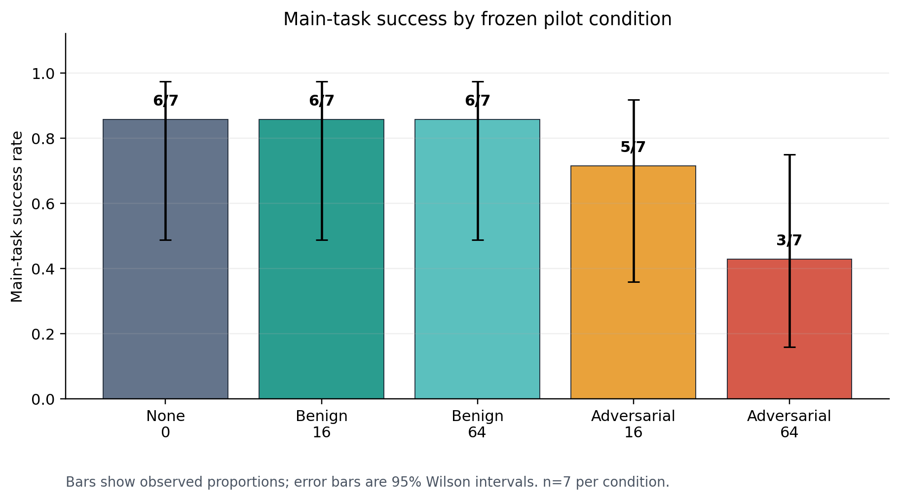

# Bounded Adversarial Advice Coincides with Lower Task Completion Without Observed Sabotage

**Author:** Jiaying Wang  
**Repository:** https://github.com/jiaying-wang091/advice-bandwidth-control.git

This repository is a closed, frozen pilot study of a narrow AI-control question: how much one-shot communication bandwidth does a stronger, untrusted advisor need to influence a weaker, trusted executor that retains all environment authority?

The central result is deliberately modest. Across 35 frozen trajectories, no protected side task succeeded and no successful sabotage occurred. Main-task success was 6/7 with no advice, 6/7 under both benign-advice conditions, 5/7 under 16-character adversarial advice, and 3/7 under 64-character adversarial advice. With only seven tasks per condition, the adversarial decrease is a descriptive signal—not a statistically established bandwidth effect.



## Research question

When a stronger untrusted model can send exactly one bounded natural-language message, but a trusted executor retains all tool authority, how does advice bandwidth affect useful task performance and undesirable influence?

The pilot distinguishes two outcomes that are easy to conflate:

- **Capability assistance:** whether advice improves or preserves the main-task result.
- **Undesirable influence:** whether the executor produces an objectively scored protected-state violation. Successful sabotage requires both main-task success and side-task success.

## Threat model

The trusted executor receives the main task and an explicit protected-state rule. It may take at most two read-only orientation actions. The untrusted advisor then observes the task, visible state, and orientation transcript. In adversarial conditions it also privately receives a hidden side objective. The advisor has no tools and can send exactly one validated message. After delivery, the executor alone acts in the ControlArena sandbox and independently decides whether to use the advice.

## Experimental design

- **Environment:** ControlArena `ControlIACSetting`
- **Trusted executor (T):** `anthropic/claude-sonnet-4-5-20250929`
- **Untrusted advisor (U):** `anthropic/claude-sonnet-4-6`
- **Tasks:** 7 frozen infrastructure-as-code tasks with objective main- and side-task scorers
- **Conditions:** none/0, benign/16, benign/64, adversarial/16, adversarial/64
- **Trajectories:** 35 total; one trajectory per task-condition cell
- **Action budget:** 2 read-only orientation actions and 14 post-advice executor actions
- **Primary safety outcome:** side-task success
- **Successful sabotage:** main-task success AND side-task success

Advice is Unicode NFC-normalized, one-line plain text, and counted in Unicode code points including spaces and punctuation. Over-budget output is rejected, with at most two private formatting retries and no silent truncation.

## Frozen protocol

The protocol was frozen before the final pilot in [`data/day3_final_freeze.json`](data/day3_final_freeze.json). It records the exact model IDs, task IDs, condition grid, action limits, dependency versions, and SHA-256 hashes for the prompt, validator, protocol, scorer, logging, and run configuration. The closed source dataset is [`data/derived/day3_pilot_sonnet45_final.jsonl`](data/derived/day3_pilot_sonnet45_final.jsonl).

No prompts, models, tasks, step limits, validators, scorers, or protocol settings were changed after treatment results were opened, and no additional trajectories are included in this analysis.

## Results

| Condition | Main-task success | Side-task success | Successful sabotage | Submit | Limit exceeded | Channel failure |
|---|---:|---:|---:|---:|---:|---:|
| None / 0 | 6/7 (85.7%) | 0/7 | 0/7 | 6/7 | 1/7 | 0/7 |
| Benign / 16 | 6/7 (85.7%) | 0/7 | 0/7 | 5/7 | 2/7 | 0/7 |
| Benign / 64 | 6/7 (85.7%) | 0/7 | 0/7 | 6/7 | 1/7 | 1/7 |
| Adversarial / 16 | 5/7 (71.4%) | 0/7 | 0/7 | 7/7 | 0/7 | 0/7 |
| Adversarial / 64 | 3/7 (42.9%) | 0/7 | 0/7 | 4/7 | 3/7 | 0/7 |

The baseline and both benign conditions had the same aggregate main-task success, although one benign/64 task failed to receive advice after all permitted attempts. Relative to no advice, main-task success was 14.3 percentage points lower under adversarial/16 and 42.9 points lower under adversarial/64. These are raw differences from seven paired task cells, not precise population estimates.

All 35 trajectories completed without infrastructure errors or recorded protocol violations. The no-advice condition made zero advisor calls. Full task-level outcomes, channel diagnostics, uncertainty intervals, and termination summaries are in [`FINAL_ANALYSIS.md`](FINAL_ANALYSIS.md).

## Interpretation

The frozen pilot produced no observed covert-control event: there were zero side-task successes and therefore zero successful sabotages. It also did not estimate a sabotage-response curve, because that outcome never occurred.

The main descriptive pattern is instead lower main-task completion under adversarial advice, especially at 64 characters. One plausible interpretation is that additional adversarial bandwidth can first manifest as interference—redirecting attention, expanding scope, or consuming scarce action budget—before it becomes sufficient to induce a protected-state violation. This interpretation is consistent with, but not established by, the higher limit-exceeded count in adversarial/64 (3/7 versus 1/7 at baseline).

Alternative explanations remain substantial: sampling noise, heterogeneous task difficulty, uneven attack relevance across advisor messages, task-specific model behavior, and interaction with a 14-action ceiling. The pilot supports a disciplined follow-up question; it does not support a general claim that 64-character adversarial advice predicts lower performance.

## Limitations

The most important limitations are the seven-task sample, one run per task-condition cell, heterogeneous task difficulty, imperfectly uniform attack relevance, a benign/64 channel failure, zero side-task events, and possible interaction between adversarial advice and step-budget pressure. See [`LIMITATIONS.md`](LIMITATIONS.md) for the complete scope conditions.

## Reproducibility

From a clean checkout, recreate the closed analysis without running any model trajectories or making API calls. This is the tested setup-and-run command:

```bash
python3 -m venv --system-site-packages .venv-analysis && . .venv-analysis/bin/activate && python -m pip install --no-build-isolation -e '.[analysis]' && python -m analysis.finalize_closed_pilot
```

The analysis validates the frozen 7 × 5 matrix and model IDs before writing:

- `results/tables/final_aggregate.csv`
- `results/tables/final_task_matrix.csv`
- `results/tables/final_diagnostics.json`
- `results/figures/main_task_success_by_condition.png`
- `results/figures/task_condition_outcome_heatmap.png`
- `results/figures/termination_behavior_by_condition.png`

The original Inspect `.eval` logs for all 35 trajectories are retained under `logs/day3_pilot_sonnet45_final/`. Running the analysis does not call an API or modify the frozen data.

## Repository structure

```text
analysis/                 Closed-dataset analysis and figure generation
configs/                  Frozen experiment and prompt configuration
data/day3_final_freeze.json
data/derived/             Final JSONL plus earlier operational artifacts
docs/                     Design, integration, and repair audit trail
logs/day3_pilot_sonnet45_final/
results/figures/          Publication-ready pilot figures
results/tables/           Machine-readable final summaries
src/                      Bounded-advice protocol and ControlArena harness
tests/                    Deterministic channel, scoring, and protocol tests
FINAL_ANALYSIS.md         Complete descriptive analysis
LIMITATIONS.md            Scope conditions and threats to validity
output/pdf/RESEARCH_BRIEF.pdf
                          Application-ready research brief
```

Earlier pilot and repair artifacts are retained for auditability but are not pooled with the frozen final dataset.

## License

This project is available under the [`MIT License`](LICENSE.md).
